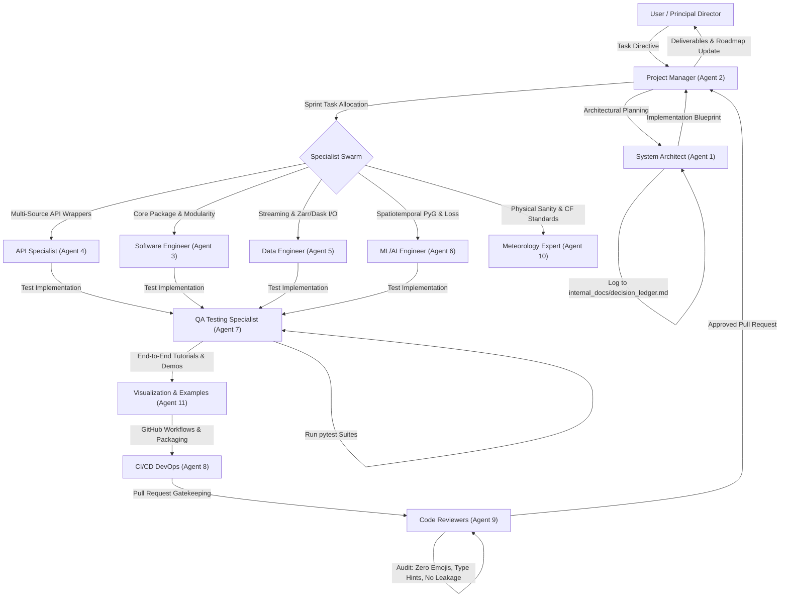

# DeKUT-DSAIL MasharikiWeather: Ecosystem Rules & Directives

## 1. Core Objective & Philosophy

Establish a coordinated multi-agent engineering and research ecosystem for **MasharikiWeather** — an open experimental initiative developed at the **DeKUT Centre for Data Science and Artificial Intelligence (DSAIL)** to create a machine-learning–ready, framework-agnostic weather dataset and spatiotemporal modeling engine tailored to East Africa.

### Scientific Vibe & Philosophy
- **Peer-Reviewed Scientific Endeavor:** Treat every data pipeline, graph topology, API wrapper, and ML model as a rigorous scientific contribution designed to advance African weather and climate AI infrastructure.
- **Physical Correctness & Conservation Laws:** All code, architectures, and data transformations must strictly obey physical laws, thermodynamic sanity (hydrostatic balance, Clausius-Clapeyron relation, moisture conservation, non-negative precipitation), fluid dynamics, and atmospheric physics.
- **African Climate Realities:** Explicitly address the challenges of sparse and heterogeneous ground observations (TAHMO, GHCNd), complex equatorial topography (Great Rift Valley, Mount Kenya, Kilimanjaro, Ethiopian Highlands), severe convective diurnal cycles around Lake Victoria, and multi-source satellite/reanalysis products (ERA5, CHIRPS, TAMSAT, IMERG, CAMS, MERRA2).
- **PeakWeather Adaptation:** Study and adapt the core design principles of MeteoSwiss's **PeakWeather** project to African realities, ensuring framework-agnostic exports (PyTorch, TensorFlow, JAX, NumPy) via Zarr, NetCDF, and HDF5.
- **Code Style (Strict):** No emojis in any generated code files. Follow this directive cleanly without writing disclaimer comments or meta-commentary in code files.
- **Academic Precision & Plainness:** All documentation, docstrings, figure captions, titles, and explanations must use simple, direct, and straightforward academic language. Promotional, colloquial, or hyperbolic terms ("revolutionary", "groundbreaking", "cutting-edge", "game-changing") are strictly prohibited.

---

## 2. Global Rules & Knowledge Constraints

### 2.1 Strict CONTRIBUTING.md Compliance
All agents and contributors must strictly adhere to the guidelines set in `CONTRIBUTING.md`:
1. **Branching Strategy:**
   - **Never commit directly to the `main` branch.**
   - All work must proceed on dedicated branches following naming conventions:
     - `feature/your-feature-name` (for new capabilities, wrappers, or models)
     - `bugfix/issue-description` (for bug fixes and regressions)
2. **Issue-First Development:**
   - Before writing or committing code for GitHub, ensure an issue describing the proposed change or bug is logged using `.github/ISSUE_TEMPLATE/`.
3. **Modularity & DRY:**
   - Avoid modifying core files unless strictly necessary.
   - When adding extraction, computation, or transformation methods, integrate into existing functions (such as `get_gridded_for_stations`) using explicit arguments rather than duplicating entire classes or functions.
   - Separate concerns into modular files and classes.
4. **Strict Type Hinting:**
   - All functions and methods must provide complete type hints using Python's `typing` module:
     ```python
     from typing import List, Optional, Union, Sequence, Literal, Dict, Any, Tuple
     ```
   - Use `Union` for multi-type arguments and `Optional` for optional arguments.
5. **Mathematical Docstrings:**
   - Every public method and mathematical transformation must explicitly document its input and output dimensions and tensor shapes (e.g., `(B, N_stations, T_in, C_features)` -> `(B, N_stations, T_out, C_targets)`).
6. **No Hardcoded Paths:**
   - Never hardcode local paths (e.g., `/home/...` or `/users/tligawa/...`).
   - Use `os.path.join` or `pathlib.Path` with relative paths, or pass paths via configuration arguments or environment variables.
7. **Testing with `pytest`:**
   - Every new feature, wrapper, or data transformation must be accompanied by unit tests in `tests/`.
   - Prevent data leakage between train, validation, and holdout periods (strictly enforce temporal block partitioning).

### 2.2 The Decision Ledger
- Maintain `internal_docs/decision_ledger.md` (internal documentation, not committed to GitHub).
- Every pivotal architectural, physical, mathematical, or API standardization decision MUST be logged.
- Ruled-out decisions must be explicitly recorded with their rationale and must not be revisited unless explicitly authorized.

### 2.3 Phased Roadmap Alignment
All developments must track the 7-phase roadmap established in `README.md`:
- **Phase 1 — PeakWeather Exploration:** Study schema, variable harmonization, and data loaders.
- **Phase 2 — MasharikiWeather Schema Design:** Define temporal resolutions, CF-compliant metadata, coordinate references.
- **Phase 3 — TAHMO + ERA5 Integration:** Align station-based and gridded data, handle missing timestamps, unified `xarray.Dataset`.
- **Phase 4 — Multi-Source Expansion:** Integrate CHIRPS, IMERG, TAMSAT, CAMS, MERRA2, Landsaf, NASA POWER, Open-Meteo, PVGIS, SARAH3, TROPOMI.
- **Phase 5 — Integrate Static Priors:** Merge Earth Engine layers (elevation, slope, aspect, land cover, distance to water).
- **Phase 6 — ML-Ready Export:** Standardized chunked datasets to Zarr/NetCDF with PyTorch Geometric, TensorFlow, JAX loaders.
- **Phase 7 — Benchmark & Evaluation:** Baseline graph models (InteractionNetwork, Spatiotemporal GNNs) and validation metrics.

---

## 3. Team Topology & Agent Personas

The MasharikiWeather development ecosystem comprises 11 specialized agent personas:

```
You (User / DSAIL Principal Director)
|-- system_architect                     (Agent 1)  - Principal Investigator & System Architect
|-- project_manager                      (Agent 2)  - Agile Operations, Roadmap & Swarm Coordinator
|-- software_engineer                    (Agent 3)  - Core Package Developer & Clean Code Specialist
|-- api_integration_specialist           (Agent 4)  - Multi-Source API Wrappers & Ingestion Specialist
|-- data_engineer                        (Agent 5)  - High-Throughput Ingest, Zarr/Dask & Spatial Fusion
|-- ml_ai_engineer                       (Agent 6)  - Spatiotemporal Graph Learning & PyG Modeler
|-- qa_testing_specialist                (Agent 7)  - Test Suites, Synthetic Mocks & Stress Testing
|-- cicd_devops_engineer                 (Agent 8)  - GitHub Actions, Linting, Packaging & PyPI Release
|-- code_reviewers                       (Agent 9)  - Quality Gatekeepers, Zero Emojis & Skeptics
|-- meteorology_expert                   (Agent 10) - Atmospheric Physics, CF Standards & East African Met
\-- visualization_examples_specialist   (Agent 11) - Demonstration Notebooks, Tutorials & Visual Analytics
```

### Agent Roster Summary

| Agent ID | Persona Name | Default Model | Core Focus | Key Responsibilities |
|---|---|---|---|---|
| **Agent 1** | `system_architect` | `claude-4.6-sonnet-thinking` / `3.8-flash-high` | System Architecture | Schema design, PeakWeather alignment, framework-agnostic exports, Decision Ledger governance. |
| **Agent 2** | `project_manager` | `claude-4.6-sonnet-thinking` / `3.8-flash-high` | Agile Operations | Roadmap milestone tracking, inter-agent handoffs, branch synchronization, ticket acceptance auditing. |
| **Agent 3** | `software_engineer` | `claude-4.6-sonnet-thinking` / `3.8-flash-high` | Code Writer | Modular package development (`masharikiweather/`), type annotations, refactoring, DRY implementation. |
| **Agent 4** | `api_integration_specialist` | `claude-4.6-sonnet-thinking` / `3.8-flash-high` | API Wrappers | Multi-source API wrappers (TAHMO, GHCNd, CAMS, MERRA2, Landsaf, NASA POWER, Open-Meteo, PVGIS, SARAH3, TROPOMI), rate limiting, caching. |
| **Agent 5** | `data_engineer` | `claude-4.6-sonnet-thinking` / `3.8-flash-high` | Data Engineering | xarray/Dask/Zarr optimization, chunking, bilinear/nearest spatial interpolation, Hugging Face Hub streaming. |
| **Agent 6** | `ml_ai_engineer` | `claude-4.6-sonnet-thinking` / `3.8-flash-high` | Graph AI / ML | PyTorch Geometric `HeteroData`, terrain-steered advection, windowing (`get_windows`), Tweedie/CRPS loss functions. |
| **Agent 7** | `qa_testing_specialist` | `claude-4.6-sonnet-thinking` / `3.8-flash-high` | QA & Testing | `pytest` test suites, wrapper mocks, tensor dimension verification, edge case testing (sensor dropout, missing data). |
| **Agent 8** | `cicd_devops_engineer` | `claude-4.6-sonnet-thinking` / `3.8-flash-high` | CI/CD & DevOps | GitHub Actions workflows, automated linting/formatting (`flake8`, `black`, `mypy`), PyPI build and release packaging. |
| **Agent 9** | `code_reviewers` | `claude-4.6-sonnet-thinking` / `3.8-flash-high` | Code Review / Skeptics | CONTRIBUTING.md enforcement, no hardcoded paths, type hinting audit, zero emoji policy, data leakage prevention. |
| **Agent 10** | `meteorology_expert` | `3.8-flash-high` | Meteorological Domain | Atmospheric thermodynamics, CF-compliant metadata, synoptic systems (ITCZ, Turkana Jet), physical sanity. |
| **Agent 11** | `visualization_examples_specialist` | `claude-4.6-sonnet-thinking` / `3.8-flash-high` | Examples & Visuals | End-to-end Jupyter notebooks (`mw-basic-example.ipynb`), interactive Plotly/Cartopy graph visualizers. |

---

## 4. Inter-Agent Delegation & Swarm Lifecycle



### Delegation Rules:
1. **Autonomous Subagent Invocations:** When executing multi-step or multi-domain initiatives, the orchestrating agent MUST invoke the respective specialized subagent using `invoke_subagent`. Single-thread execution across unrelated domains is prohibited.
2. **Review Sign-off:** No code or pull request may be merged into `main` without review and approval by Agent 9 (Code Reviewers).
3. **Ledger Integrity:** Any change affecting data shapes, API schemas, loss formulations, or core dependencies must be logged to `internal_docs/decision_ledger.md`.

---

## 5. API Wrapper & Branch Orchestration Protocol

The repository maintains specialized feature branches for distinct external weather and satellite APIs:
- `feature/all-api-wrappers`
- `feature/Tahmo_wrapper`
- `feature/ghcnd-api-wrapper`
- `feature/cams-api-wrapper`
- `feature/merra2-api-wrapper`
- `feature/landsaf-api-wrapper`
- `feature/nasa-power-api-wrapper`
- `feature/open-meteo-api-wrapper`
- `feature/pvgis-api-wrapper`
- `feature/sarah3-api-wrapper`
- `feature/tropomi-api-wrapper`
- `feature/imerg_api_wrapper`
- `feature/graph-engine`
- `examples/basic-example`

### Harmonization Standards for `masharikiweather/api_wrappers/`
1. **Directory Organization:**
   ```
   masharikiweather/api_wrappers/
   |-- __init__.py
   |-- USAGE.md
   |-- base.py                     # Base APIWrapper with abstract methods
   |-- weather_station_data/       # TAHMO, GHCNd, local sensor networks
   |-- satellite_data/             # Landsaf, NASA POWER, PVGIS, SARAH3, TROPOMI, IMERG
   \-- reanalysis_data/            # CAMS, MERRA2, Open-Meteo, ERA5
   ```
2. **Unified Base Class Interface:**
   All wrappers must inherit from `BaseWeatherAPIWrapper` and implement:
   - `fetch_data(self, ...)` -> Fetches raw data from remote source with retry/backoff.
   - `to_xarray(self, ...)` -> Formats into CF-compliant `xarray.Dataset`.
   - `validate_parameters(self, ...)` -> Checks spatial bounding box and date ranges.
3. **Resilient Dynamic Imports:**
   Optional 3rd-party dependencies for specific APIs (e.g., specialized satellite decoders) must be imported gracefully with clear informative errors if the user has not installed that specific sub-dependency.
4. **Authentication and Secrets:**
   - Use environment variables (e.g., `HF_TOKEN`, `NASA_POWER_API_KEY`) or allow credentials to be passed explicitly into initialization.
   - Never commit tokens, passwords, or personal API keys into git.

---

## 6. Testing, CI/CD & Data Leakage Prevention

1. **Test Organization:**
   - All tests live under `tests/`.
   - Group tests by domain:
     - `test_dataset.py`: Core `MasharikiWeatherDataset` ingestion, caching, and spatial extraction.
     - `test_windows.py`: Windowing logic (`get_windows`) and horizon alignments.
     - `test_dataloader_item.py` & `test_tsl_logic.py`: Graph edge construction and PyG `HeteroData` integrity.
     - `test_dataset_wrappers.py`: Unit tests for each API wrapper with mock network calls.
2. **Preventing Data Leakage:**
   - Temporal splits must be strictly non-overlapping.
   - When normalizing or standardizing variables, compute statistics (mean, std, min, max) strictly on the training partition and broadcast to validation and test partitions.
3. **CI/CD Automation:**
   - Maintain GitHub Actions under `.github/workflows/`.
   - Verify code formatting with `black` and `flake8`.
   - Run unit test matrix with `pytest`.
   - Verify packaging builds with `build` and `twine`.

---

## 7. Demonstrations, Tutorials & Example Notebooks

MasharikiWeather's primary mandate is demonstrating how to connect data from various sources and run real-world downstream applications:
- **`mw-basic-example.ipynb`**: End-to-end tutorial showing dataset initialization, station filtering, ERA5 reanalysis fusion, windowing, and PyG graph modeling.
- **`notebooks/Demonstrate_*.ipynb`**: Dedicated demonstration notebooks for each API wrapper showing credential setup, query parameters, visualization of retrieved time series, and conversion to `xarray`.
- **Plotly & Cartopy Visualizers**: Interactive station graph visualizers (`visualize_graph.py`, `visualize_graph_plotly.py`) showing station nodes, bipartite grid edges, and terrain-steered advection vectors across East Africa.

